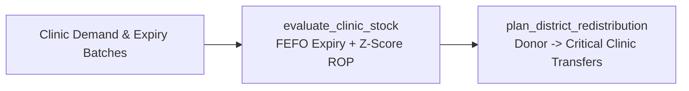

# med-stock

[](https://github.com/codesphere-u/med-stock/actions/workflows/ci.yml)
[](LICENSE)
[](pyproject.toml)
[](pyproject.toml)

**Rural clinic essential medicines (WHO EML) stockout early-warning, FEFO expiry-waste simulator, z-score safety-stock ROP calculator, and district inter-clinic redistribution planner.**

- **Mission Domain:** Healthcare Supply Chain & Public Health
- **Stack:** Pure Python 3.11+ (zero runtime third-party dependencies, `mypy --strict`, `ruff`, `pytest`)
- **Maintainer:** Codesphere Innovations (U) Limited (`codesphere-u`)

---

## Problem Solved

District health networks frequently experience life-threatening antimalarial/ORS stockouts at busy clinics at the exact same time neighboring low-volume clinics write off expiring batches.

## Key Features

- Forward FEFO batch consumption simulator quantifying exact units that will expire before dispensing (`at_risk_expiry_units`).
- Service-level z-score safety stock, Reorder Point (ROP), days-of-stock, and replenishment quantity calculator.
- Automated district-wide inter-clinic redistribution planner (`plan_district_redistribution`) rescuing expiry-risk surplus for stockout/critical clinics.

## Architecture Overview



See [docs/architecture.md](docs/architecture.md) for module-level design details.

## Installation

```bash
git clone https://github.com/codesphere-u/med-stock.git
cd med-stock
uv sync --extra dev
```

Or install in editable mode with standard `pip`:

```bash
pip install -e ".[dev]"
```

## Quick Start (CLI)

```bash
med-stock demo
```

## Quick Start (Python API)

```python
from datetime import date
from med_stock import ClinicDemandProfile, MedicineBatch, evaluate_clinic_stock

st = evaluate_clinic_stock(ClinicDemandProfile("HC3", "ACT", 20.0, 4.0, 14), [MedicineBatch("B1", "ACT", "HC3", 80, date(2027, 4, 1))], as_of=date(2026, 11, 24))
assert st.status == "critical"
```

## Testing & Quality Gates

```bash
uv run ruff check src tests
uv run mypy src
uv run pytest -v
```

## Security, Contributing & Roadmap

- **Security:** See [SECURITY.md](SECURITY.md) for responsible disclosure procedures.
- **Contributing:** See [CONTRIBUTING.md](CONTRIBUTING.md) and [CODE_OF_CONDUCT.md](CODE_OF_CONDUCT.md).
- **Changelog & Roadmap:** See [CHANGELOG.md](CHANGELOG.md) and [ROADMAP.md](ROADMAP.md).

## License

MIT License — see [LICENSE](LICENSE).

## Support & Contact

Open an issue on [GitHub Issues](https://github.com/codesphere-u/med-stock/issues) or contact `codesphereinnovationz@gmail.com`.
